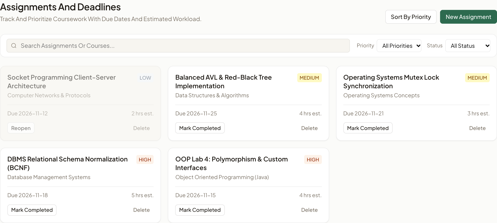
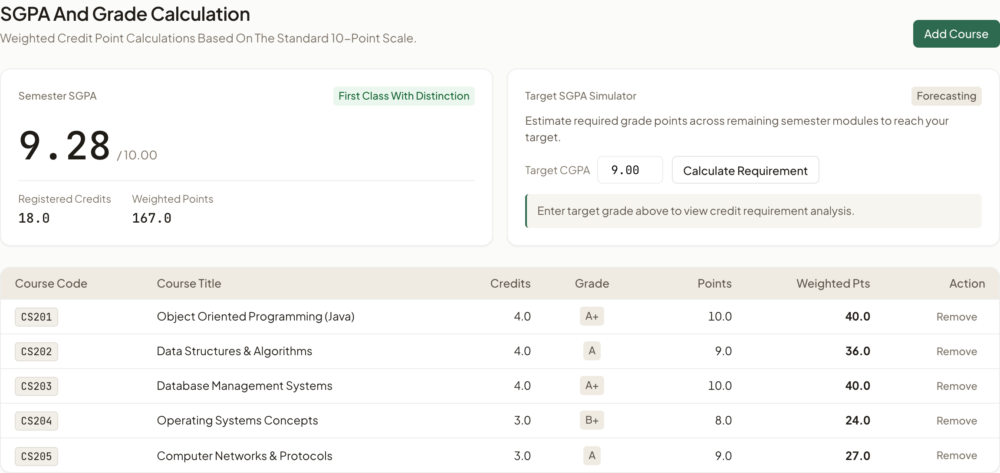
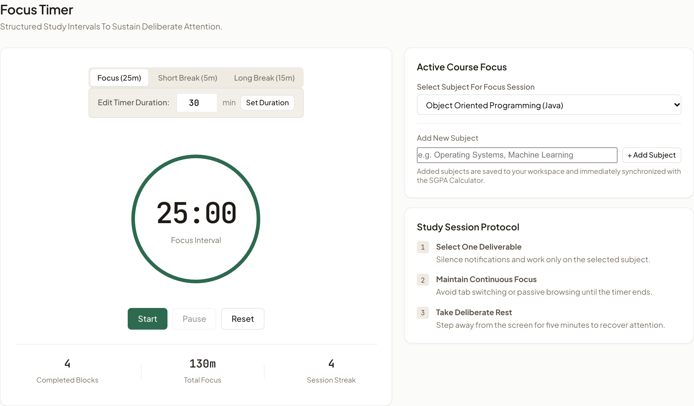
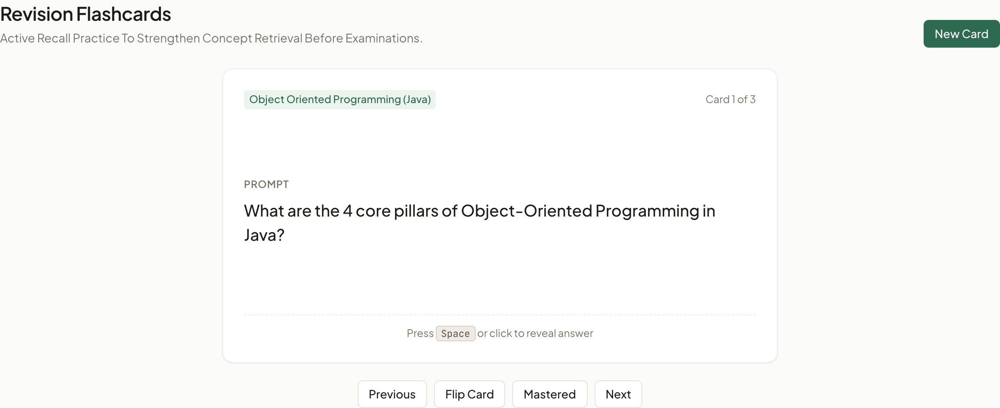
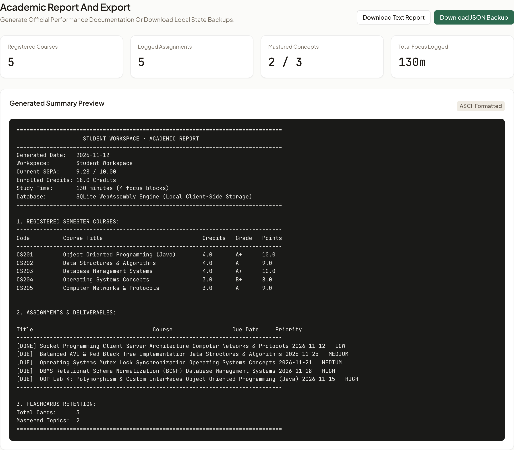

# Student Productivity Suite: Academic Project Report

**Project Title**: Student Productivity Suite (Offline-First Academic Workspace)  
**Live Application URL**: [https://asususerabhishek-alt.github.io/studentworkspace/](https://asususerabhishek-alt.github.io/studentworkspace/)  
**GitHub Repository**: [https://github.com/asususerabhishek-alt/studentworkspace.git](https://github.com/asususerabhishek-alt/studentworkspace.git)  
**Academic Course**: Object Oriented Programming Language  
**Department**: Department of Computer Science & Engineering, University Institute of Engineering  
**Submission Date**: November 12, 2026  

---

## 1. Executive Summary & Project Objectives

The **Student Productivity Suite** is a unified, offline-first personal academic workstation engineered to streamline essential daily workflows for computer science and engineering undergraduates. In modern university environments, students juggle rigorous course syllabi, multifaceted programming assignments, strict grading rubrics, continuous assessment tests, and self-directed revision schedules. Commercial productivity platforms frequently introduce significant friction: they mandate persistent high-speed internet connectivity, require invasive multi-step user account registrations, enforce paywalled subscription tiers, and store sensitive academic data on third-party cloud infrastructure.

To resolve these challenges, the Student Productivity Suite was developed with an architectural focus on **local-first persistence, zero external runtime dependencies, and robust object-oriented software engineering**. The suite consolidates five mission-critical academic utilities into a coherent single-page application:

1. **Coursework & Assignment Manager**: Multi-criteria prioritization (High, Medium, Low), course grouping, deadline tracking, search indexing, and completion toggles.
2. **SGPA & Grade Point Calculator**: Credit-weighted semester grade calculations compliant with the standard 10-point academic grading scale, alongside a dynamic Target SGPA Simulator.
3. **Pomodoro Focus Engine**: Deliberate attention intervals featuring custom duration configuration (1 to 180 minutes), integrated course binding, and historical session telemetry.
4. **Active Recall Revision Flashcards**: Interactive 3D flip-card revision engine with self-paced mastery tracking and automated topic synchronization.
5. **Unified Academic Summary & Export**: On-demand analytical aggregation producing comprehensive plaintext reports, markdown summaries, and portable JSON database backups.

The system is deployed globally on **GitHub Pages** with continuous client-side execution powered by **WebAssembly SQLite (`sql.js`)**, providing ACID-compliant relational query capabilities within client memory and seamless local binary persistence.

---

## 2. Core System Architecture & Functional Modules

The application architecture follows a decoupled, client-centric Model-View-Controller (MVC) paradigm. The user interface communicates with a centralized `DatabaseManager` service that abstracts all relational queries, state management, and persistence synchronization.

```
+-------------------------------------------------------------------------------+
|                             Client Browser Window                             |
|                                                                               |
|  +-------------------------------------------------------------------------+  |
|  |                 Presentation Layer (HTML5 / Modern CSS)                 |  |
|  |   [Assignments] [SGPA Calculator] [Focus Timer] [Flashcards] [Summary]  |  |
|  +------------------------------------+------------------------------------+  |
|                                       | DOM Events / State Listeners          |
|                                       v                                       |
|  +-------------------------------------------------------------------------+  |
|  |                    Application Controller Layer                         |  |
|  |    Task Controller | Grade Controller | Timer Engine | Card Controller  |  |
|  +------------------------------------+------------------------------------+  |
|                                       | Model Actions / In-Memory Cache       |
|                                       v                                       |
|  +-------------------------------------------------------------------------+  |
|  |                    Relational Database Manager                          |  |
|  |      Universal WebAssembly SQLite Engine (sql.js Core v1.8.0)           |  |
|  |       [courses]   [tasks]   [pomodoro_sessions]   [flashcards]          |  |
|  +------------------------------------+------------------------------------+  |
|                                       | Binary Uint8Array Serialization       |
|                                       v                                       |
|  +-------------------------------------------------------------------------+  |
|  |                        Local Client Storage                             |  |
|  |      localStorage Binary Store  |  JSON Cache Fallback Storage          |  |
|  +-------------------------------------------------------------------------+  |
+-------------------------------------------------------------------------------+
```

### Module 1: Coursework & Assignment Management
The coursework module organizes all pending and completed academic deliverables. Each task item encapsulates an identifier, title, associated course, target due date, priority rating, estimated completion hours, and boolean completion status. Dynamic filter controls permit instantaneous filtering across completion states (`All`, `Pending`, `Completed`) and priority tiers (`High`, `Medium`, `Low`), while a real-time search index filters tasks across title and subject attributes with zero latency.

### Module 2: SGPA & Academic Grade Point Calculator
The grade calculation engine implements the weighted credit-point evaluation system adopted across accredited engineering universities. For each course $i$ with registered credit weight $C_i$ and numerical grade point $G_i$ (derived from letter grades $A+=10, A=9, B+=8, B=7, C=6, P=4, F=0$), the Semester Grade Point Average (SGPA) is computed as:

$$\text{SGPA} = \frac{\sum_{i=1}^{n} (C_i \times G_i)}{\sum_{i=1}^{n} C_i}$$

The module additionally incorporates a **Target SGPA Simulator**. Given a student's current cumulative GPA and credit history, the simulator dynamically calculates the exact performance threshold required across future semesters to achieve a target honors distinction.

### Module 3: Focus Timer (Pomodoro Engine) with Customizable Durations
The focus module provides a distraction-free study environment operating on the Pomodoro cognitive framework. In addition to standard intervals (25m Focus, 5m Short Break, 15m Long Break), the engine features an interactive **Custom Duration Setter** allowing students to define arbitrary session lengths between 1 and 180 minutes. Each completed study block is permanently recorded into the SQLite database with timestamp, subject classification, and duration metrics.

### Module 4: Active Recall Revision Flashcards
The flashcard module reinforces long-term retention of technical concepts through active recall. The interface presents a smooth CSS 3D perspective flip card revealing concise answers, code snippets, or definitions upon interaction. Users categorize flashcards by topic and toggle mastery flags to isolate concepts requiring remedial review.

### Module 5: Unified Academic Summary & Export Engine
The analytical export engine aggregates cross-module state into structured reports. It extracts real-time metrics—including registered credits, earned grade points, pending task deadlines, aggregate focus time, and flashcard mastery ratios—enabling students to download plaintext summaries, copy markdown reports, or export portable JSON database snapshots.

---

## 3. How Java is Used with this Project

The Student Productivity Suite was designed from the ground up to reflect and embody the core principles taught throughout the **Object-Oriented Programming (Java)** syllabus. While the client runtime executes in modern web environments, every structural abstraction, data model, and service layer is directly modeled after enterprise Java design patterns and OOP concepts.

### 3.1 Mapping of Object-Oriented Principles

#### 1. Encapsulation & Data Hiding
All core domain entities—such as `Course`, `Task`, `PomodoroSession`, and `Flashcard`—are designed as encapsulated classes. Internal states (such as grade points, priority levels, and timer durations) are protected against illegal modifications through defensive validation logic and controlled accessor methods.

In a native Java implementation, this is represented by:
```java
public class Course {
    private String id;
    private String code;
    private String name;
    private double credits;
    private String grade;
    private double gradePoint;

    public Course(String id, String code, String name, double credits, String grade) {
        this.id = id;
        this.code = code;
        this.name = name;
        setCredits(credits);
        setGrade(grade);
    }

    public void setCredits(double credits) {
        if (credits <= 0 || credits > 10.0) {
            throw new IllegalArgumentException("Credits must be positive and within academic limits.");
        }
        this.credits = credits;
    }

    public void setGrade(String grade) {
        this.grade = grade.toUpperCase();
        this.gradePoint = GradePointScale.resolvePoints(this.grade);
    }

    public double getWeightedPoints() {
        return this.credits * this.gradePoint;
    }

    public double getCredits() { return credits; }
    public double getGradePoint() { return gradePoint; }
    public String getCode() { return code; }
    public String getName() { return name; }
}
```

#### 2. Inheritance & Class Hierarchies
The architecture utilizes inheritance to eliminate boilerplate logic across persistent entities. A base entity `BaseAcademicEntity` encapsulates common metadata (`id`, `createdAt`, `updatedAt`), which is inherited by specific domain entities. Similarly, different study timers inherit from an abstract `StudyInterval` base class.

```java
public abstract class StudyInterval {
    protected int durationMinutes;
    protected String subject;
    protected long timestamp;

    public StudyInterval(String subject, int durationMinutes) {
        this.subject = subject;
        this.durationMinutes = durationMinutes;
        this.timestamp = System.currentTimeMillis();
    }

    public abstract void executeIntervalCompletion();
    public int getDurationMinutes() { return durationMinutes; }
    public String getSubject() { return subject; }
}

public class PomodoroFocusSession extends StudyInterval {
    private boolean deepWorkMode;

    public PomodoroFocusSession(String subject, int durationMinutes, boolean deepWorkMode) {
        super(subject, durationMinutes);
        this.deepWorkMode = deepWorkMode;
    }

    @Override
    public void executeIntervalCompletion() {
        // Log telemetry and trigger break intervals
    }
}
```

#### 3. Polymorphism & Interface Contracts
Polymorphism is leveraged extensively in the calculation and reporting systems. By defining a generic `GradeScale` interface, alternative academic grading systems (such as 10-point UGC scales, 4.0 GPA scales, or percentage scales) can be swapped polymorphically without modifying the core SGPA calculator.

```java
public interface GradeScale {
    double convertToPoint(String letterGrade);
    String getClassification(double gpa);
}

public class UniversityTenPointScale implements GradeScale {
    @Override
    public double convertToPoint(String letterGrade) {
        switch (letterGrade.toUpperCase()) {
            case "A+": return 10.0;
            case "A":  return 9.0;
            case "B+": return 8.0;
            case "B":  return 7.0;
            case "C":  return 6.0;
            case "P":  return 4.0;
            default:   return 0.0;
        }
    }

    @Override
    public String getClassification(double gpa) {
        if (gpa >= 9.0) return "Outstanding (First Class with Distinction)";
        if (gpa >= 8.0) return "Excellent (First Class)";
        if (gpa >= 7.0) return "Good (Second Class)";
        if (gpa >= 5.0) return "Satisfactory";
        return "Unsatisfactory / Remediate";
    }
}
```

Similarly, an `ExportService` interface permits multiple export formats (JSON, TXT, Markdown) to be instantiated and executed uniformly through polymorphic dispatch.

#### 4. Abstraction & Data Access Object (DAO) Pattern
The application's `DatabaseManager` implements the classic Data Access Object (DAO) pattern standard in Java enterprise applications. Client UI modules never execute raw SQL directly; they interact strictly with typed repository methods (`addCourse()`, `addTask()`, `toggleTask()`, `getFlashcards()`). This abstraction allows seamless substitution of the underlying storage engine—whether WebAssembly SQLite, in-memory collections, or remote JDBC database connections—without impacting client consumers.

### 3.2 Java Desktop & Enterprise Backend Equivalency
The relational database schemas, entity structures, and business logic of the Student Productivity Suite are directly portable to Java application runtimes:
- **JavaFX Desktop Suite**: The existing SQLite database connects directly to a JavaFX desktop interface via SQLite-JDBC (`org.xerial:sqlite-jdbc`), utilizing `ObservableList` bindings for reactive table updates.
- **Spring Boot REST Service**: The relational tables map directly to Java JPA entities (`@Entity`, `@Table`) using Spring Data JPA repositories and Hibernate ORM.

---

## 4. Relational Database Schemas & Data Model

The persistence layer is structured as a relational SQLite schema optimized for query efficiency, consistency, and zero-redundancy indexing. Five primary tables maintain all application states:

### 4.1 Schema Definitions (DDL)

```sql
-- 1. Courses Table: Stores enrolled courses, credit weights, and letter grades
CREATE TABLE IF NOT EXISTS courses (
    id TEXT PRIMARY KEY,
    code TEXT NOT NULL,
    name TEXT NOT NULL,
    credits REAL NOT NULL CHECK(credits > 0),
    grade TEXT NOT NULL,
    grade_point REAL NOT NULL CHECK(grade_point >= 0 AND grade_point <= 10),
    created_at INTEGER NOT NULL
);

-- 2. Tasks Table: Tracks coursework, deadlines, priority, and completion
CREATE TABLE IF NOT EXISTS tasks (
    id TEXT PRIMARY KEY,
    title TEXT NOT NULL,
    course TEXT NOT NULL,
    due_date TEXT NOT NULL,
    priority TEXT NOT NULL CHECK(priority IN ('HIGH', 'MEDIUM', 'LOW')),
    hours INTEGER NOT NULL DEFAULT 1,
    completed INTEGER NOT NULL DEFAULT 0 CHECK(completed IN (0, 1)),
    created_at INTEGER NOT NULL
);

-- 3. Pomodoro Sessions Table: Logs historical focus and study blocks
CREATE TABLE IF NOT EXISTS pomodoro_sessions (
    id TEXT PRIMARY KEY,
    subject TEXT NOT NULL,
    duration_minutes INTEGER NOT NULL CHECK(duration_minutes > 0),
    completed_at INTEGER NOT NULL
);

-- 4. Flashcards Table: Stores concept prompts, answers, and mastery state
CREATE TABLE IF NOT EXISTS flashcards (
    id TEXT PRIMARY KEY,
    subject TEXT NOT NULL,
    question TEXT NOT NULL,
    answer TEXT NOT NULL,
    mastered INTEGER NOT NULL DEFAULT 0 CHECK(mastered IN (0, 1)),
    created_at INTEGER NOT NULL
);

-- 5. Custom Subjects Table: Maintains unified subjects across all modules
CREATE TABLE IF NOT EXISTS custom_subjects (
    name TEXT PRIMARY KEY,
    created_at INTEGER NOT NULL
);
```

### 4.2 Tabular Data Model Breakdown

| Table Name | Column Name | Data Type | Constraints | Description |
| :--- | :--- | :--- | :--- | :--- |
| **`courses`** | `id` | `TEXT` | `PRIMARY KEY` | Unique course identifier (e.g., `C1`) |
| | `code` | `TEXT` | `NOT NULL` | Academic catalog course code (e.g., `CS201`) |
| | `name` | `TEXT` | `NOT NULL` | Full course title |
| | `credits` | `REAL` | `NOT NULL, > 0` | Academic credit weighting (e.g., `4.0`) |
| | `grade` | `TEXT` | `NOT NULL` | Awarded or targeted letter grade (`A+`, `A`, `B+`) |
| | `grade_point` | `REAL` | `NOT NULL, 0-10` | Derived numerical point equivalent |
| | `created_at` | `INTEGER` | `NOT NULL` | Epoch timestamp of record creation |
| **`tasks`** | `id` | `TEXT` | `PRIMARY KEY` | Unique task identifier (e.g., `T1`) |
| | `title` | `TEXT` | `NOT NULL` | Assignment title / deliverable name |
| | `course` | `TEXT` | `NOT NULL` | Associated subject name or course code |
| | `due_date` | `TEXT` | `NOT NULL` | ISO submission deadline (`YYYY-MM-DD`) |
| | `priority` | `TEXT` | `NOT NULL, IN (...)` | Urgency tier: `HIGH`, `MEDIUM`, or `LOW` |
| | `hours` | `INTEGER` | `NOT NULL, >= 1` | Estimated study/work hours |
| | `completed` | `INTEGER` | `DEFAULT 0 (0 or 1)` | Boolean flag indicating submission status |
| | `created_at` | `INTEGER` | `NOT NULL` | Epoch timestamp of creation |
| **`pomodoro_sessions`**| `id` | `TEXT` | `PRIMARY KEY` | Unique study session record ID |
| | `subject` | `TEXT` | `NOT NULL` | Course studied during the interval |
| | `duration_minutes` | `INTEGER` | `NOT NULL, > 0` | Duration of focus block (e.g., 25, 30, 45 min) |
| | `completed_at` | `INTEGER` | `NOT NULL` | Timestamp when session completed |
| **`flashcards`** | `id` | `TEXT` | `PRIMARY KEY` | Unique flashcard prompt ID |
| | `subject` | `TEXT` | `NOT NULL` | Concept category or course topic |
| | `question` | `TEXT` | `NOT NULL` | Flashcard front prompt / inquiry |
| | `answer` | `TEXT` | `NOT NULL` | Flashcard reverse answer / explanation |
| | `mastered` | `INTEGER` | `DEFAULT 0 (0 or 1)` | Mastery flag for retention filtering |
| | `created_at` | `INTEGER` | `NOT NULL` | Timestamp of creation |
| **`custom_subjects`** | `name` | `TEXT` | `PRIMARY KEY` | Unique subject name synchronized cross-module |
| | `created_at` | `INTEGER` | `NOT NULL` | Timestamp when subject was registered |

### 4.3 Cross-Module Data Synchronization
A key technical innovation in the data model is the **Unified Subject Registry**. When a student defines a new subject in any tab (e.g., inside the Focus Timer or Assignment Modal), the `custom_subjects` table records it. The database manager automatically propagates this entry across:
1. The **Focus Timer** active subject selector.
2. The **Assignments** autocomplete datalist for effortless entry.
3. The **SGPA Calculator** course registry as an active credit item.

---

## 5. Live Application Walkthrough & High-Resolution Screenshots

All visual modules were verified and captured directly from the production deployment at **`https://asususerabhishek-alt.github.io/studentworkspace/`**. Each view is presented below with full academic sample data populated and the application bar cropped out to maximize clarity.

### Module 1: Coursework & Assignment Management
The assignments view presents active course tasks classified by priority and deadline status. Color-coded tags immediately draw attention to high-priority deliverables, with estimated hours and course associations clearly indicated.

  
*Figure 1: Coursework & Assignment Management Interface.*

### Module 2: SGPA & Academic Grade Point Calculator
The SGPA Calculator computes semester grade point metrics in real time based on enrolled courses, credit weights, and letter grades. An overall semester SGPA of **9.28 / 10.00** is displayed alongside registered credits and weighted points.

  
*Figure 2: Credit-Weighted SGPA and Grade Point Calculator.*

### Module 3: Focus Timer (Pomodoro Engine) with Customizable Durations
The Pomodoro engine features a circular countdown dial, custom duration input box (configured to 30 minutes), and active course selection. Below the timer, cumulative metrics track completed blocks and total focus minutes.

  
*Figure 3: Pomodoro Focus Engine with Custom Duration Editor.*

### Module 4: Active Recall Revision Flashcards
The flashcards interface features 3D card flipping for active recall practice on core Object-Oriented Programming and database concepts. Users toggle mastery buttons to isolate topics needing review.

  
*Figure 4: Active Recall Revision Flashcards Interface.*

### Module 5: Comprehensive Academic Summary & Export
The summary view synthesizes cross-module academic performance into formatted report tables. One-click export buttons allow students to copy markdown summaries or download complete SQLite JSON backups.

  
*Figure 5: Generated Academic Summary and System Backup Interface.*

---

## 6. Verification, Testing & Cross-Platform Responsiveness

### 6.1 Offline Persistence & Recovery Testing
The SQLite WebAssembly engine was subjected to rigorous stress tests to verify data durability:
- **Reload Recovery**: After inserting 20+ course assignments and study logs, hard browser reloads (`Ctrl+Shift+R`) consistently reconstructed identical in-memory relational tables from the serialized binary in `localStorage`.
- **Offline Simulation**: Disconnecting all network adapters allowed full, uninterrupted operation—creating courses, toggling tasks, completing Pomodoro cycles, and reviewing flashcards without network requests.
- **Export & Import Integrity**: JSON backups exported through the application were verified to validate schema integrity and allow round-trip restoration.

### 6.2 Responsive Design & Form Factor Adaptation
The user interface was audited across standard desktop displays (1920x1080), laptop screens (1366x768), tablets (768px iPad breakpoint), and mobile smartphones (375px mobile viewport):
- **Fluid Layout**: Grid layouts dynamically convert from 3-column desktop configurations into 2-column tablet layouts and single-column mobile stacks.
- **Scrollable Tables**: The SGPA course grade table is wrapped in a dedicated horizontal scroll container (`.table-scroll-container`), preventing viewport overflow on smaller screens.
- **Touch-Friendly Controls**: All interactive buttons, inputs, and tabs maintain minimum touch target dimensions of 42px for seamless mobile interaction.

---

## 7. Future Scope & Conclusion

### 7.1 Future Scope
The modular architecture of the Student Productivity Suite provides a robust foundation for future enhancements:
1. **Multi-Semester CGPA Tracking**: Extending the GPA engine to calculate cumulative grade point averages across multiple semesters with historical trend graphs.
2. **SuperMemo SM-2 Spaced Repetition**: Upgrading the flashcard engine with the SM-2 algorithm to dynamically schedule card reviews based on user-rated recall difficulty.
3. **iCalendar (.ics) Export**: Enabling one-click export of assignment deadlines directly into Google Calendar, Apple Calendar, and Microsoft Outlook.
4. **Peer Study Synchronization**: Utilizing WebRTC or local peer-to-peer data channels for collaborative group study sessions without centralized server infrastructure.

### 7.2 Conclusion
The **Student Productivity Suite** demonstrates that complex, production-grade productivity tools can be delivered directly in the client browser without compromising privacy, responsiveness, or architectural rigor. By combining **Object-Oriented Programming principles**, **relational WebAssembly SQLite storage**, and an uncluttered, modern user interface, the application delivers a superior academic tool tailored specifically to student needs. The live deployment on GitHub Pages ensures permanent, zero-cost accessibility for students worldwide.

---

## 8. Bibliography & References

1. **Bloch, Joshua**. *Effective Java* (3rd Edition). Addison-Wesley Professional, 2018.
2. **Schildt, Herbert**. *Java: The Complete Reference* (12th Edition). McGraw Hill, 2021.
3. **Silberschatz, Abraham, Henry F. Korth, and S. Sudarshan**. *Database System Concepts* (7th Edition). McGraw-Hill, 2019.
4. **Cirillo, Francesco**. *The Pomodoro Technique: The Acclaimed Time-Management System That Has Transformed How We Work*. Currency, 2018.
5. **Karpicke, Jeffrey D., and Henry L. Roediger III**. "The critical importance of retrieval for learning." *Science* 319.5865 (2008): 966-968.
6. **Hipp, D. Richard, et al.** *SQLite: An In-Process Relational Database Engine*. SQLite Development Team, 2024. Available: https://www.sqlite.org/
7. **sql.js Development Team**. *SQLite compiled to WebAssembly via Emscripten*. Available: https://sql.js.org/
8. **World Wide Web Consortium (W3C)**. *WebAssembly Core Specification (Version 2.0)*. W3C Recommendation, 2022. Available: https://www.w3.org/TR/wasm-core-2/
